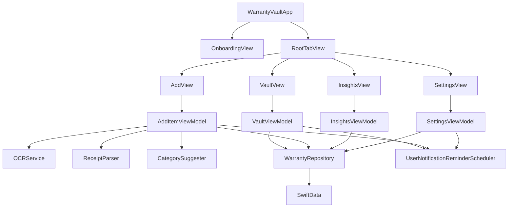

# Warranty Vault

Warranty Vault is an iOS app for keeping purchase receipts and the warranties that cover them. You import a receipt photo or PDF, review the details the app reads from it, and get a reminder before the cover ends.

## Features

- Save a warranty by importing a receipt from Photos or Files, or by typing the details.
- Read the store, purchase date, and total from the receipt on the device, then highlight values that need a second look.
- Suggest a category from the receipt text.
- Browse the vault as a list or a grid, search by name, and filter by active, expiring soon, or expired.
- Open a warranty to see the receipt, days remaining, and a shareable summary, then edit, archive, or delete it.
- Chart category counts, monthly spending, and upcoming expiries.
- Schedule a local reminder 30 days, 7 days, and 1 day before a warranty ends, at 9:00 in the morning.
- Send a test reminder and list the notifications still waiting to be delivered.
- Export the vault as CSV, choose light, dark, or system appearance, and clear all data.
- English and Sinhala strings, Dynamic Type, and VoiceOver labels. Amounts are shown as `Rs. 129,900.00` and spoken as rupees.

## Tech stack

- Swift 5 and SwiftUI
- iOS 17.6 minimum for the app. The test targets use iOS 18.5.
- SwiftData for the warranty store
- MVVM, with `Observation` view models and a `WarrantyRepository` in front of the store
- Vision for on-device text recognition. There is no camera capture.
- NaturalLanguage for category suggestions
- UserNotifications for the 30/7/1-day reminders
- Swift Testing for unit tests and XCTest for UI tests

## Architecture

Views never use `ModelContext` directly. They read and write through `WarrantyRepository`. Navigation uses a `NavigationStack` and a typed `Route` owned by `AppRouter`.



## Build and run

1. Open `WarrantyVault.xcodeproj` in **Xcode 16.4** (build 16F6).
2. Select the **WarrantyVault** scheme.
3. Choose an **iPhone 16** simulator on **iOS 18.6**. The app itself deploys to iOS 17.6 and later.
4. Run. The first launch shows a three-page introduction. After that, the app opens on the Vault tab.

From the command line, with the simulator already available:

```bash
xcodebuild -project WarrantyVault.xcodeproj -scheme WarrantyVault \
  -destination 'platform=iOS Simulator,name=iPhone 16,OS=18.6' \
  build
```

## Folder structure

```text
WarrantyVault/
  WarrantyVaultApp.swift          App entry, onboarding gate, UI-test launch arguments
  Models/                         WarrantyItem, status, category, preview seeds
  ViewModels/                     Vault, add, insights, and settings state
  Views/                          Screens for each tab, onboarding, and settings
  Components/                     Cards, buttons, pickers, empty and loading states
  Services/                       Repository, OCR, receipt parser, reminders
  Utilities/                      Theme, router, currency, CSV, summary text
  Resources/                      Category keyword list
  Assets.xcassets/                Brand colors, including dark-mode variants
  Localizable.xcstrings           English and Sinhala
WarrantyVaultTests/               Swift Testing unit tests
WarrantyVaultUITests/             XCTest UI tests
```

## Testing

Unit tests use Swift Testing (`import Testing`, `@Test`, `#expect`). UI tests use XCTest.

Turn **parallel testing off** for UI tests. They share one simulator and reset or seed the same store, so two tests running at once will race. In Xcode, edit the WarrantyVault scheme, open Test, and turn off parallel execution. From the command line, pass `-parallel-testing-enabled NO`:

```bash
xcodebuild -project WarrantyVault.xcodeproj -scheme WarrantyVault \
  -destination 'platform=iOS Simulator,name=iPhone 16,OS=18.6' \
  -parallel-testing-enabled NO \
  test
```

To run one suite, add `-only-testing:WarrantyVaultTests/ReceiptParserTests` or `-only-testing:WarrantyVaultUITests/WarrantyVaultUITests`.

The UI tests pass these launch arguments. `WarrantyVaultApp` reads them before the first screen appears. Leave them in place. The tests depend on them.

| Argument | Effect |
| --- | --- |
| `-skipOnboarding` | Opens the tabs even when the introduction has not been finished. |
| `-resetOnboarding` | Shows the introduction again for this launch. |
| `-resetVault` | Deletes every saved warranty before the interface appears. |
| `-seedVault` | Deletes the store, then inserts **Active Lamp** (still covered) and **Expired Fan**. |
| `-useSampleReceipt` | DEBUG builds only. Import receipt skips Photos and Files and reads a bundled sample image. The scanning screen stays up long enough to photograph. Seeded rows include that image. |

`testMainTabsExist` uses `-skipOnboarding` and `-resetVault`. `testOnboardingIsShownOnce` uses `-resetOnboarding` and `-resetVault`, then relaunches with `-resetVault` only. The filter and delete tests use `-skipOnboarding` and `-seedVault`. The launch-performance test uses `-skipOnboarding`.

## Known limitations

- There is no camera capture, by design. Receipts are imported from Photos or Files.
- A SwiftData fetch that asks for only some columns crashes when a column is an enum, so status, search, and sort stay in memory after the rows are loaded.
- OCR accuracy varies with photo quality.
- The 30/7/1-day reminders cannot be observed live, so they are verified through the pending-reminders list and mock-scheduler tests.
